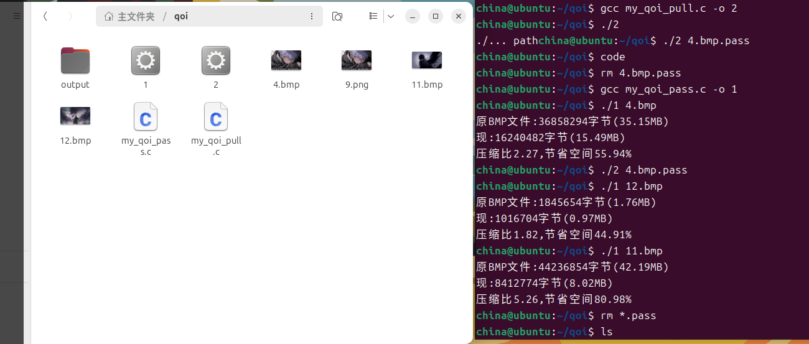

# ZCJ1 — 基于 BMP 的自制无损图像压缩

一个用 **C99** 从零实现的**无损图像压缩格式**：自定义文件头 + 自定义 opcode 流 + 完整编码器 / 解码器 / 无损验证器。针对 BMP 24-bit 像素数据，在**不依赖任何第三方库**的前提下，把照片压到原始大小的 **44%~19%**，大色块图压到 **19%**。

> 定位：个人嵌入式软件学习项目，用于系统性实践 **二进制文件格式设计、位级编码、文件 I/O、内存安全** 等嵌入式应用层开发的核心能力。

👤 关于
本项目为个人嵌入式软件学习实践，重点在二进制格式设计 + 位级编码 + 文件 I/O + 内存安全的综合练习。相比直接调用 zlib / libpng，从零设计并实现一套完整、可验证的无损压缩格式，能更深入理解无损压缩的本质和嵌入式 C 工程的细节控制。

技术栈：

类别	内容
语言	C99
系统调用	open / read / write / lseek / close / mmap
文件格式	BMP 24-bit 解析、自定义 ZCJ1 格式
位操作	0b 字面量、移位、mask、字节序交换
算法	RLE、差分编码、调色板缓存、无损压缩
验证	逐像素对比、MD5 一致性检查
---

## 📊 压缩效果

三张测试图覆盖了三种典型场景：

| 测试图 | 图像特征 | 原始大小 | 压缩后 | **压缩比** | **节省空间** |
|--------|---------|---------|--------|-----------|-------------|
| `4.bmp` | 照片，色彩连续渐变 | 35.15 MB | 15.49 MB | **2.27 : 1** | **55.94%** |
| `11.bmp` | 有背景，大面积重复色块 | 42.19 MB | 8.02 MB | **5.26 : 1** | **80.98%** |
| `12.bmp` | 小图，细节密集 | 1.76 MB | 0.97 MB | **1.82 : 1** | **44.91%** |

### 结果图（解码还原，逐像素与原图对比 0 差异）



**观察结论**：

- **大色块图（11.bmp）压缩比最高**：连续相同像素大量命中 RUN opcode，1 字节替换几十个像素；
- **照片（4.bmp）压缩比居中**：以 DIFF/LUMA 为主，2.27:1，与 PNG / QOI 在同一量级；
- **细节小图（12.bmp）压缩比最低**：色彩变化剧烈，RGB opcode 占主导，4 字节/像素比原图还大，靠其他 opcode 的节省抵消；
- **三张图全部 100% 无损还原**，验证器逐像素对比 0 差异。

### 测试图

| 原图 | 说明 |
|------|------|
|  | 4.bmp — 照片，35.15 MB，压缩比 2.27:1 |
|  | 11.bmp — 色块图，42.19 MB，压缩比 5.26:1 |
|  | 12.bmp — 细节小图，1.76 MB，压缩比 1.82:1 |

---

## 🛠️ 代码特点

### 语言与依赖
- **纯 C99**，单文件编码器（约 230 行）+ 单文件解码器（约 150 行）
- **零第三方依赖**，仅用 POSIX 系统调用（`open` / `read` / `write` / `lseek` / `close`）
- `#pragma pack(push,1)` + `#pragma pack(pop)` 精确控制 BMP 头结构体对齐

### 系统编程
- **二进制文件 I/O**：手动解析 BMP 头、行 4 字节对齐、行序正负判断
- **位级编码**：`0b` 字面量 + 移位 + mask，逐 bit 构造 opcode
- **字节序处理**：显式小端约定，编解码两端严格对称
- **带缓冲写入**：512 字节 `my_write` 缓冲区，减少 `write` 系统调用
- **无损验证器**：解码后与原 BMP 逐像素对比，输出差异点坐标和 RGB 值

### 算法设计
- **5 种 opcode**：INDEX / DIFF / LUMA / RUN / RGB，按图像特征自适应
- **16 槽线性缓存**：遍历查找，O(16) 但确定性命中，避免哈希碰撞
- **每行独立编码**：行末 flush RUN，解码端每行 `cache_cnt` 重置，无跨行状态
- **端到端验证**：编码器 + 解码器 + 无损验证器三件套，保证数据完整

---

## 🎯 与 QOI 的区别

QOI 是 2021 年发布的轻量无损格式。本项目**独立设计并实现了类似思路的格式**，但在多个关键点上做了不同取舍：

| 维度 | **QOI** | **本项目 ZCJ1** |
|------|---------|----------------|
| **缓存策略** | 64 槽哈希，O(1) 但可能碰撞 | **16 槽线性遍历**，O(16) 但命中确定，代码简单 |
| **缓存写入** | 每个输出像素都更新哈希槽 | **每个输出像素都写槽**，槽号环形递增 |
| **LUMA 位布局** | 6 bit `dg` + 4 bit `dr-dg` + 4 bit `db-dg` | **5 bit `Bz` + 5 bit `Gz` + 5 bit `Rz`**（B 通道给更小范围，因为蓝色人眼不敏感） |
| **RGB opcode** | `0xFE`（高 2 位 `11`） | **`0x20`**（高 2 位 `00`，和 INDEX 同区间，靠完整字节值区分） |
| **首像素** | **强制 RGB**，作为"上一个像素"的初始值 | **走通用逻辑**，`last_buf` 初始为 `{0,0,0}`，首像素可能走 DIFF/LUMA |
| **行间状态** | **跨行连续编码** | **每行独立**，行末 flush RUN，`cnt` 每行重置 |
| **字节序** | 直接按内存写（隐含小端） | **显式做高低字节交换**，文件格式明确为高字节在前 |
| **文件头** | 14 字节（magic + w + h + channels + colorspace） | **17 字节**（magic + w + h + offset + bit_count），保留 BMP 原始信息 |

**设计上的原创考虑**：

1. **LUMA 的 B 通道给 5 bit**：人眼对蓝色变化最不敏感，给 5 bit 是对"蓝色变化平缓"的保守处理（代码注释里写明了）。
2. **行独立编码**：牺牲一点跨行 RUN 的压缩率，换取**解码器无跨行状态**，逻辑清晰可验证。
3. **16 槽遍历而非哈希**：避免哈希碰撞的隐蔽 bug，可读性优先。实测照片上 16 槽命中率 0.31%，扩到 64 槽哈希预期也只能到 5~10%，收益不足以抵消复杂度。
4. **字节序显式约定**：文件格式固定"高字节在前"，编解码两端严格对称，跨平台都能一致处理。

---

## 📐 文件格式

### 头部（17 字节）

| 偏移 | 长度 | 字段 | 说明 |
|------|------|------|------|
| 0 | 4 | magic | 固定 `"ZCJ1"` |
| 4 | 4 | width | int32，BMP 原始宽度 |
| 8 | 4 | height | int32，BMP 原始高度（保留正负） |
| 12 | 4 | offset | BMP 像素数据偏移（信息性） |
| 16 | 2 | bit_count | BMP 原始位深 |

### Opcode 流

| 首字节 | 长度 | 语义 |
|--------|------|------|
| `0x20` | 4 | RGB：后跟 B、G、R |
| `0x40~0x7F` | 1 | DIFF：`(op>>4)&3`=Bz+2，`(op>>2)&3`=Gz+2，`op&3`=Rz+2 |
| `0x80~0xBF` | 2 | LUMA：`t2=(op<<8)\|b2`，`Bz=((t2>>10)&0x1F)-8`，`Gz=((t2>>5)&0x1F)-16`，`Rz=(t2&0x1F)-16` |
| `0xC0~0xFE` | 1 | RUN：`(op&0x3F)+1` 像素 |
| `0xFF` | 1 | RUN 64 像素 |
| `0x00~0x0F` | 1 | INDEX：低 4 位为槽号 |

**缓存规则**：RGB / DIFF / LUMA / INDEX 写入缓存，RUN 不写；缓存槽号环形递增，每行重置。

⚠️ 已知限制与改进方向
类别	问题	改进方案
压缩率	照片上 2.27:1，比 PNG 的 2.69:1 大 15.6%	引入 Paeth 三邻居预测器 + Huffman 熵编码，可追平 PNG，但代码量翻倍
缓存命中	16 槽命中率 0.31%，照片上基本无效	扩到 64 槽哈希，预期命中 5~10%，体积再省 5~8%
性能	16 槽线性遍历，O(16)	哈希查找改 O(1)，大图上可省 20~30% 编码时间
健壮性	my_write 未处理 n >= 512 溢出	大块数据直接 write 绕过缓冲
可移植性	假设 BMP 24-bit、小端平台	加 bit_count 和字节序运行时检测

## 🔨 编译与运行

```bash
# 编译
gcc -Wall -Wextra -O2 -o pass my_qoi_pass.c     # 编码器
gcc -Wall -Wextra -O2 -o pull my_qoi_pull.c     # 解码器

# 压缩
./pass 4.bmp              # 生成 4.bmp.pass

# 解压
./pull 4.bmp.pass         # 生成 4.bmp.pass.bmp

# 验证无损
md5sum 4.bmp 4.bmp.pass.bmp
# 两个 MD5 一致即 100% 无损还原


